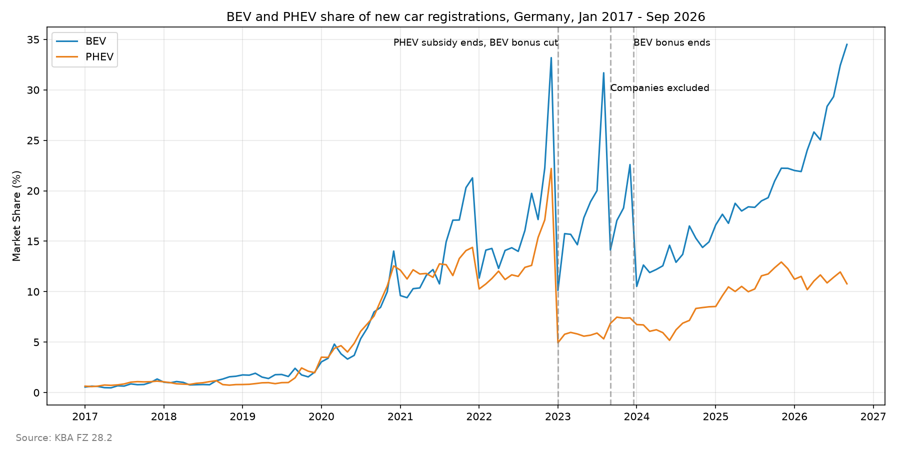
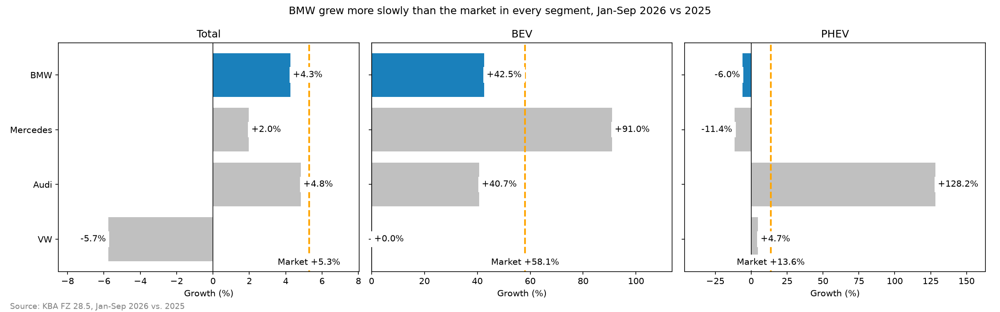
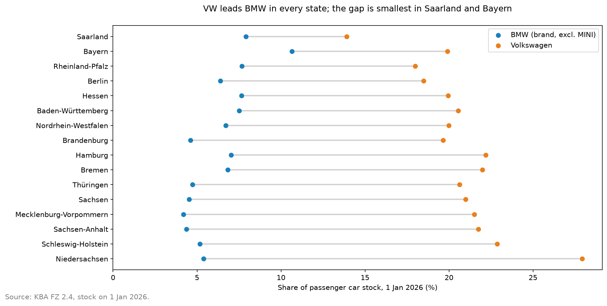
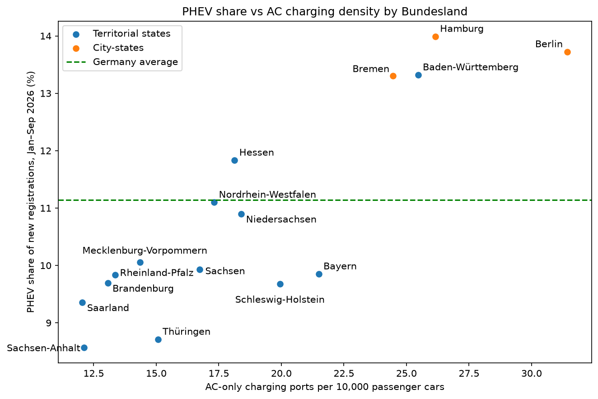
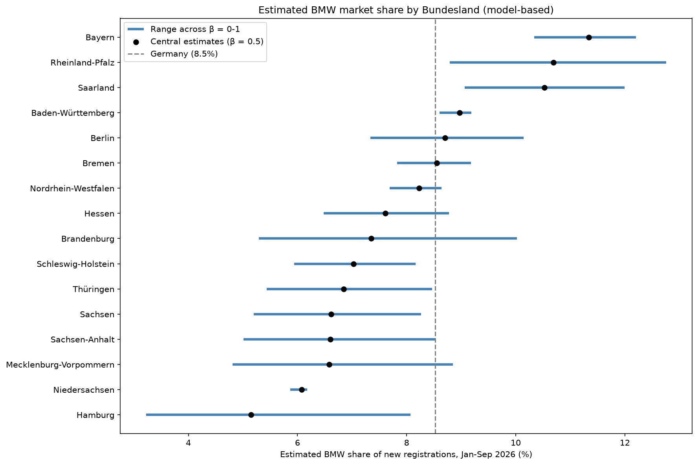

# BMW and the German Electric Vehicle Market

An exploratory data analysis of BMW's competitive position in Germany's new-car market, electric vehicle (EV) adoption across the 16 German federal states (Bundesländer), and the relationship between charging infrastructure and regional EV adoption.

**Scope:** Germany only. **Stack:** Python, pandas, NumPy, SciPy, Matplotlib, seaborn, Jupyter Notebook.

---

## Key results

- **BMW grew more slowly than the market in every segment** (Jan–Sep 2026 vs 2025): total +4.3% vs +5.3%, BEV +42.5% vs +58.1%, PHEV −6.0% vs +13.6%.
- **BMW has the strongest home effect of any major brand, but VW still leads in Bayern.** BMW's share of the Bayern car fleet is 1.66 times its share in the rest of Germany. Even so, VW has the most cars on the road in Bayern (19.9% vs 10.6%) and leads BMW in every state.
- **PHEV adoption follows AC charging density; BEV adoption does not.** Among the 13 territorial states, PHEV share correlates with AC charging density (r = 0.73, partial r = 0.68 after controlling for population density). BEV share shows no clear association.

---

## Questions

1. How does BMW compare with other brands in total new registrations and market share?
2. How is BMW performing in battery-electric (BEV) and plug-in hybrid (PHEV) registrations?
3. How strong is BMW in its home state Bayern compared with other brands and other states?
4. How does BEV and PHEV adoption differ across the 16 Bundesländer?
5. How does AC and DC charging infrastructure differ across the Bundesländer?
6. Is regional EV adoption associated with charging infrastructure density?
7. How might BMW registrations be distributed regionally? *(model estimate)*

---

## Findings

### National EV trend



BEV and PHEV shares of national new registrations, 2017 to September 2026, with the subsidy changes marked: the end of the PHEV subsidy and the BEV bonus cut (January 2023), the exclusion of companies (September 2023) and the end of the BEV bonus (17 December 2023).

### BMW vs the German market, Jan–Sep 2026 vs Jan–Sep 2025



| Category | BMW growth | Market growth | BMW share change |
|---|---|---|---|
| Total registrations | +4.25% | +5.28% | −0.08 pp |
| BEV | +42.53% | +58.07% | −0.89 pp |
| PHEV | −5.99% | +13.63% | −2.11 pp |

- BMW grew in total and BEV registrations, but more slowly than the market in all three categories.
- BMW's own lineup shifted strongly toward BEVs: the BEV share of BMW's registrations rose from about 19.0% to 25.9% (+6.96 pp).
- BMW lost ground in PHEVs on every measure.

### BMW's home market: Bayern



Based on passenger car stock on 1 January 2026 (FZ 2.4), not new registrations.

- **Home index** = a brand's share of the Bayern fleet / its share of the rest-of-Germany fleet. The BMW brand (excl. MINI) has 1.66, the highest of the 20 largest manufacturers (BMW group incl. MINI: 1.61; Audi: 1.36). Mercedes-Benz (0.83) and VW (0.94) are below 1.
- **Ranking:** the BMW brand is 2nd in Bayern and 5th in the rest of Germany. VW is 1st in both.
- **BMW vs VW by state:** VW leads in every state. The gap is smallest in Saarland (6.0 pp, mainly because VW is weak there) and Bayern (9.3 pp). It is largest in Niedersachsen (22.5 pp), VW's own home state. BMW has less than 5% of the fleet in the eastern states.

### Charging infrastructure and EV adoption



Among the 13 territorial states, PHEV share is positively associated with AC charging density (r = 0.73), and the association remains after controlling for population density (partial r = 0.68). Across all 16 states, part of the correlation reflects the city-states' high density. BEV share shows no clear association with charging density or population density. These associations are cross-sectional and do not show that AC charging causes PHEV adoption; company-car concentration is a plausible common factor.

### Estimated regional BMW registrations



KBA does not publish new registrations by brand and Bundesland. BMW's national Jan–Sep 2026 registrations were therefore allocated to states by BMW-brand stock (FZ 2.4, MINI excluded), adjusted by each state's registration intensity with a parameter β ∈ [0, 1]. Results are reported as the range across β, with β = 0.5 as the central value.

**Robust findings:** above the national 8.5% in every scenario: Bayern, Rheinland-Pfalz, Saarland and Baden-Württemberg. Below in every scenario: Niedersachsen and Hamburg.

**Caveats:**
- Model estimates, not observed registrations, and not validated for BMW.
- Estimated shares largely reflect where BMW's existing fleet is.
- One β for all states; manufacturer self-registrations near BMW sites are not modelled.
- An untyped stock row (≈1%) cannot be split between BMW and MINI.

---

## Data sources

| Data | Source | Content | Reference period |
|---|---|---|---|
| FZ 28.2 | Kraftfahrt-Bundesamt (KBA) | National monthly registrations by drive type | 2017–Sep 2026 |
| FZ 28.4 | KBA | New registrations by brand and drive type | September 2026 |
| FZ 28.5 | KBA | New registrations by brand and drive type | Jan–Sep 2026 and Jan–Sep 2025 |
| FZ 28.9 | KBA | New registrations by Bundesland and drive type | Jan–Sep 2026 |
| FZ 10 | KBA | New registrations by model series | September 2026 |
| FZ 2.3 | KBA | Passenger car stock by manufacturer and Bundesland | 01.01.2026 |
| FZ 2.4 | KBA | Passenger car stock by manufacturer, trade name, type and Bundesland | 01.01.2026 |
| Charging stations | Bundesnetzagentur charging station register (export) | Stations, charging ports, connector types | Downloaded 01.11.2026 |
| Ladesäulenregister | Bundesnetzagentur | Commissioning dates of charging stations | 30.09.2026 |
| 12411-0021 | Destatis | Population by Bundesland | 30.06.2026 |
| 11111-0001 | Destatis | Area by Bundesland (km²) | 31.12.2023 |

Raw files are stored unchanged in `data/raw/`. Cleaned datasets are saved to `data/processed/`.

---

## Methods and validation

- All extracted brand and regional totals were reconciled with the KBA total rows ("Insgesamt" / period totals) using assertions.
- National market totals were cross-checked independently against FZ 28.2.
- Brand tables were merged on normalized brand names with outer-merge checks, so no brand is lost through spelling differences. Brands with no September registrations are filled with 0 for September only.
- Growth is left undefined (NaN) for brands with no registrations in the base year.
- "Sonstige" (registrations not assigned to a Bundesland) is kept for reconciliation and excluded from regional comparisons.
- Charging stations were assigned to Bundesländer using postal codes and city/district information, with zero missing assignments. All 118,219 charging ports in the dataset have connector information. Commissioning dates were matched from the official register for 92.9% of stations.
- Charging infrastructure is normalized three ways: per 100,000 inhabitants, per 10,000 passenger cars in stock, and per 1,000 km².
- Correlations were run with Pearson and Spearman, with and without the city-states (Berlin, Hamburg, Bremen), and with a partial correlation controlling for log population density. P-values for partial correlations are approximate.
- For the home-market analysis, FZ 2.4 subtotal rows ("ZUSAMMEN") were excluded, and the BMW total was checked against its subtotal row. Every row's state values were checked to add up to the national total. Manufacturer names were merged across plant countries (for example AUDI (D) and AUDI (H); DAIMLER and MERCEDES-BENZ).

---

## Definitions

- **Registrations, not sales.** All registration figures are KBA new registrations (*Neuzulassungen*). They are not retail sales and not BMW Group worldwide deliveries.
- **Stock** (*Fahrzeugbestand*) is all registered passenger cars on 1 January 2026. It shows where cars are on the road, not current purchases.
- **BMW** refers to the BMW brand only. KBA lists MINI as a separate brand. In the stock data (FZ 2.4), MINI is part of the BMW manufacturer and was removed by trade name.
- **BEV:** battery-electric vehicle. **PHEV:** plug-in hybrid. **FCEV:** hydrogen fuel cell vehicle. FCEVs are excluded from PHEV wherever the data allows.
- **Year-to-date PHEV** (Jan–Sep) is calculated as electric-drive total minus BEV, because FZ 28.5 has no separate PHEV column. Nationally this includes at most 11 FCEVs (2026) and 47 FCEVs (2025), which is negligible. September PHEV figures come from a dedicated PHEV column.
- **Charging port** = *Ladepunkt*: one vehicle can charge at a time. A port can have several connector types.
- **DC port:** a port with at least one DC connector (CCS or CHAdeMO). **AC-only port:** a port with no DC connector.
- **Station-level flags:** `has_AC` / `has_DC` mark stations offering at least one AC / DC connector. One station can count in both.
- **Growth** is reported in **%**. Changes in shares are reported in **percentage points (pp)**.

### Metrics

| Metric | Formula |
|---|---|
| Market share | Brand registrations / all registrations |
| BEV market share | Brand BEVs / all BEVs |
| PHEV market share | Brand PHEVs / all PHEVs |
| Internal BEV share | Brand BEVs / brand's total registrations |
| Internal PHEV share | Brand PHEVs / brand's total registrations |
| Year-over-year growth | (Jan–Sep 2026 − Jan–Sep 2025) / Jan–Sep 2025 |
| Regional BEV / PHEV share | State BEVs (PHEVs) / state total registrations |
| BEV-to-PHEV ratio | BEVs / PHEVs |
| Fleet share | Brand stock in a region / all stock in that region |
| Home index | Brand's Bayern fleet share / brand's rest-of-Germany fleet share |

---

## Limitations

- **Registration location:** vehicles are registered at the holder's address. Company fleets, leasing and rental firms inflate registrations in some states, most visibly Hamburg. Near BMW sites, company cars and employee leasing probably add to BMW's stock as well.
- **Small sample:** with 16 Bundesländer, correlations are exploratory and cannot establish causality.
- **Time alignment:** commissioning dates are available for 92.9% of charging stations (latest 24.09.2026). The remaining 7.1% have no date, so the infrastructure snapshot cannot be aligned exactly with the registration period.
- **Stock vs registrations:** the home-market analysis uses the car fleet on 1 January 2026. It shows where brands' cars are, not who leads current sales in each state.
- **Small brands:** growth rates for low-volume brands are volatile and can be extreme.
- **Regional BMW estimates** are model-based allocations, not observed registrations, and are not statistically validated.

---

## Repository structure

```
data/
  raw/          original source files (unchanged)
  processed/    cleaned datasets (Parquet)
reports/
  figures/      charts used in this README
src/
  01_clean_charging_stations.ipynb
  02_brand_analysis.ipynb
  03_regional_analysis.ipynb
requirements.txt
README.md
```

## How to run

1. Create the environment and install dependencies (Python 3.12):
```bash
pip install -r requirements.txt
```
2. Place the source files in `data/raw/`.
3. Run the notebooks in numerical order: 01 → 02 → 03. Notebook 03 reads the outputs of 01 and 02.
